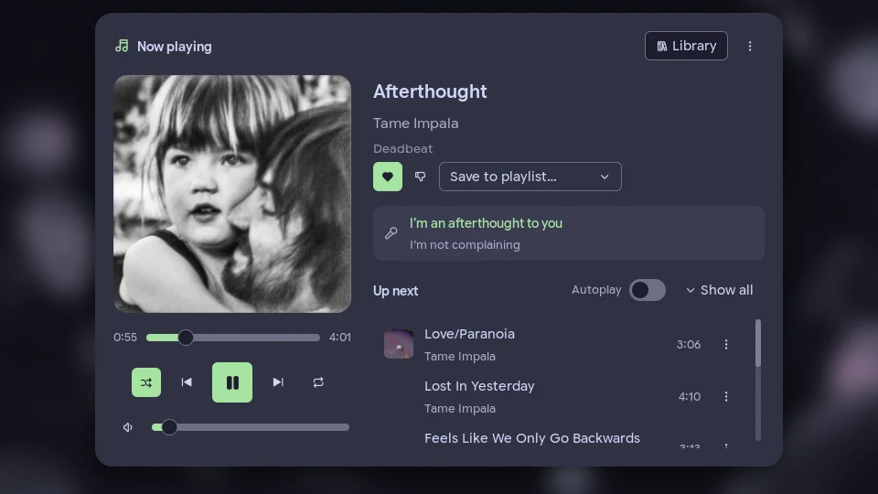

# Sonolith Noctalia integration

What's playing in [Sonolith](https://github.com/opecko/sonolith) (a YouTube Music client), right in your
Noctalia bar: album art, title and artist, a Now Playing panel with every control you need, and your whole
library a click away.



## Plugin

| Field | Value |
| --- | --- |
| ID | `opecko/sonolith` |
| Entries | Service: `service`; bar widget: `bar`; panels: `nowplaying`, `library` |
| Needs | Noctalia 5.4 or newer (plugin API 43), Sonolith 2.4 or newer, `python3` |
| Optional | ImageMagick (`magick` or `convert`): scales album art down, which keeps the panels smooth. Secret Service (`secret-tool`): keeps the token in your keyring instead of a user-only file |

## Installation

Add this repo as a plugin source and enable the plugin:

```sh
noctalia msg plugins source add sonobar git https://github.com/opecko/sonobar
noctalia msg plugins enable opecko/sonolith
```

Then put the bar widget on a bar, either from the bar settings or in your config:

```toml
[widget.sonolith]
type = "opecko/sonolith:bar"
```

and add `"sonolith"` to one of the bar's `start`, `center` or `end` lists.

In Sonolith, turn on **Settings → Connected apps → Let other apps connect to Sonolith**.

## Connecting

Click the widget and press **Connect to Sonolith**. Sonolith shows a consent screen with what the plugin wants
to do (see [Permissions](#permissions)); you can untick any optional permission. After you allow it, the plugin
connects on its own every time Noctalia starts. It never asks Sonolith again without you pressing a button,
and it never starts Sonolith by itself.

**Disconnect from Sonolith** is in the Now Playing panel's ⋮ menu. It removes the plugin from Sonolith and
deletes its token, also when Sonolith isn't running.

## Using it

### Bar widget

Album art, title and artist; dimmed while paused. Left click opens Now Playing, right click plays or pauses,
the mouse wheel changes the volume (or skips, see settings), middle click opens the widget's settings. On a
vertical bar it shows the art only, with the song in the tooltip. When Sonolith isn't running or isn't
connected, it shows an icon and says so in the tooltip (or hides, if you prefer).

### Now Playing

Art and controls on the left: seek, previous / play / next, shuffle and repeat, volume (click the speaker to
mute). For podcast episodes, skip back 10 s / forward 30 s and the speed replace shuffle and repeat. On the
right: like, dislike and save to playlist, the current lyric line (lit up word by word when Sonolith has word
timings) with the next one under it, and what's up next with autoplay. A queue entry's ⋮ moves it to play next
or removes it (right click for the same as a menu).

### Library

Your playlists, liked songs, albums, artists, podcasts, episodes for later and history, plus search with
suggestions and filters. Click a playlist, album, artist or podcast to open it; click a song to play it in that
playlist or album. ▶ on a card plays it; right click on ▶ or on a row's ⋮ for more (play next, add to queue,
like, save to playlist, go to album or artist, remove from your own playlist). **← Now playing** at the top of
the rail goes back.

## Settings

Plugin settings (Settings → Plugins → the gear on this plugin):

| Key | Default | |
| --- | --- | --- |
| `volume_step` | `5` | Volume change per wheel step or keybind, in percent |
| `osd_on_track_change` | `false` | Show the shell OSD with the new song |
| `np_layout` | `compact` | `compact` or `large_art` (a bigger cover in Now Playing) |
| `np_show_lyrics` | `true` | Show the current lyric line |
| `np_show_queue` | `true` | Show what's up next |
| `np_queue_preview` | `6` | Queue entries shown before "Show all" |
| `library_default_tab` | `last` | The tab Library opens on |

Widget settings (per bar widget):

| Key | Default | |
| --- | --- | --- |
| `show_art`, `show_title`, `show_artist` | `true` | What to show; all off falls back to an icon |
| `layout` | `inline` | `inline` (one line) or `stacked` (title over artist) |
| `text_format` | `{title} · {artist}` | For `inline`; placeholders `{title}`, `{artist}`, `{album}` |
| `order` | `title_first` | For `stacked`: `title_first` or `artist_first` |
| `art_size`, `art_radius` | `22`, `6` | In px |
| `max_width` | `240` | Longer text is cut off with … |
| `show_state_icon` | `true` | Play/pause icon after the text |
| `show_progress` | `false` | A thin progress line under the text |
| `when_idle` | `glyph` | Nothing playing: `glyph`, `hide` or `last_track` |
| `when_unavailable` | `glyph` | Sonolith not running: `glyph` or `hide` |
| `scroll_action` | `volume` | Mouse wheel: `volume`, `track` (next/previous) or `none` |
| `scroll_long_text` | `false` | Long text scrolls instead of being cut off (advanced) |

## Keybinds (IPC)

Bind these in your compositor:

```sh
noctalia msg plugin opecko/sonolith:service all toggle       # play / pause
noctalia msg plugin opecko/sonolith:service all next
noctalia msg plugin opecko/sonolith:service all previous
noctalia msg plugin opecko/sonolith:service all like         # like / remove the like
noctalia msg plugin opecko/sonolith:service all volume-up    # by volume_step
noctalia msg plugin opecko/sonolith:service all volume-down
noctalia msg plugin opecko/sonolith:service all open         # toggle Now Playing
noctalia msg plugin opecko/sonolith:service all library      # toggle Library
noctalia msg plugin opecko/sonolith:service all connect      # Connect to Sonolith
noctalia msg plugin opecko/sonolith:service all disconnect   # Disconnect from Sonolith
```

## Permissions

What the plugin asks Sonolith for, as the consent screen shows it. Only "See what's playing" is required;
anything you untick is simply hidden in the plugin, and the Library offers to ask for library access later.

| Scope | Why |
| --- | --- |
| `player:read` (required) | To show the current song in your bar |
| `player:control` | To play, pause, skip and seek from your bar |
| `queue:read` | To show what's up next |
| `queue:write` | To add, move and remove songs in your queue |
| `lyrics:read` | To show the current lyric line |
| `library:read` | To browse your library |
| `search` | To search YouTube Music |
| `library:write` | To like songs and save them to playlists |

## How it works

Noctalia plugins can't open Unix sockets, and Sonolith's API is JSON-RPC over one. The plugin's service runs a
small Python bridge (`bridge/sonolith-bridge.py`, standard library only) that holds the one connection to
Sonolith, prints status and events to the service as JSON lines, and runs the panels' commands through a
private control socket in `$XDG_RUNTIME_DIR/sonolith-noctalia/`. The bar and panels only read the service's
shared state.

- The bridge runs from a copy in the plugin's data directory
  (`~/.local/state/noctalia/plugins/data/opecko/sonolith/`). Sonolith ties the token to the script's path,
  and that copy keeps the same path across plugin updates, so an update never asks you to approve the plugin
  again.
- The token lives in the Secret Service (`secret-tool`), or in a user-only file in that directory when there
  is no keyring. It is never logged, shown or put on a command line.
- Album art is downloaded into `art/` in the same directory (about 80 covers are kept). With ImageMagick, each
  cover is kept as a 512 px and a 128 px copy.
- The plugin uses Sonolith's events, not polling: the only extra request is the queue preview after the queue
  changes.

## Sonolith integration checklist

From the [Sonolith API spec](https://github.com/opecko/sonolith/blob/master/api/SPEC.md):

- [x] 1. Connects through `discovery.json`, falling back to the default socket; checks the `/tmp` fallback
  directory is private
- [x] 2. One JSON message per line, at most 1 MiB; responses matched by id; unknown fields and notifications
  ignored
- [x] 3. Registers only after a user action, with a stable appId, a clear name, description and publisher, and
  a plain reason per scope
- [x] 4. Keeps the connection open while a request is pending; handles approved, denied (with the wait from
  `retryAfterMs`), blocked and expired
- [x] 5. Token in the Secret Service (fallback: a 0600 file); never logged or shown
- [x] 6. `session.hello` first on every connection; handles Unauthorized, NotRegistered, Blocked,
  RegistrationPending (identity changed) and UnsupportedVersion
- [x] 7. Uses only granted scopes; follows `session.scopesChanged`; hides features on PermissionDenied
- [x] 8. On `session.revoked`, Unauthorized or NotRegistered: stops, deletes the token, shows "Disconnected
  from Sonolith"
- [x] 9. Never registers again on its own
- [x] 10. "Disconnect from Sonolith" calls `app.unregister` and deletes the token
- [x] 11. "Uses Sonolith" next to Disconnect and on the connect screens
- [x] 12. Reconnects with backoff (1 s doubling to 60 s, ±20% jitter, or at once when Sonolith reappears);
  never starts Sonolith on its own; subscribes again after reconnecting
- [x] 13. Events, not polling
- [x] 14. Respects rate limits: waits `retryAfterMs`, debounces search and sliders
- [x] 15. Handles Unavailable, Timeout, NotSignedIn, NotFound and `cursorExpired`
- [x] 16. Tested with Sonolith not running, the API off, and Sonolith quitting mid-session
- [x] 17. Tested deny, block, expiry, an unticked optional scope, removal in Sonolith while connected, and
  disconnect

## Troubleshooting

- **"Sonolith isn't running, or Connected apps are off"**: start Sonolith and turn on Settings → Connected
  apps → Let other apps connect to Sonolith. The plugin notices within a second.
- **"Python 3 is required"**: install `python3`.
- **The panels feel slow with lots of covers**: install ImageMagick.
- Logs: `grep sonolith ~/.cache/noctalia/noctalia.log`.

Uses [Sonolith](https://github.com/opecko/sonolith).
